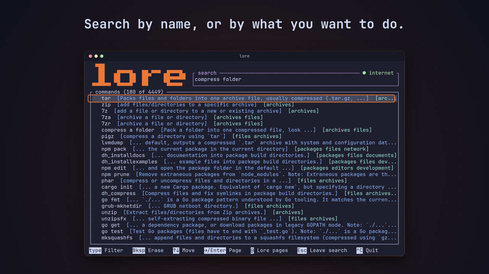

# lore

**Every command you can type, A to Z, and a page for each one — in your
terminal, offline.**

`lore` lists every command on your machine (programs, your shell's
builtins, your aliases) and opens a short, practical page for any of them:
what it does, the examples you actually need, which package it came from,
and what can go wrong. For Linux and macOS, with bash, zsh or fish.

[](media/lore.mp4)

*▶ Click the picture for the 20-second video.* Here is the same app as text:

```text
  ▀██
   ██   ▄█▀▀▀█▄  ██▄▀▀▀ ▄█▀▀▀█▄  ┌ search ───────────────────────────────── ● internet ┐
   ██   ██   ██  ██     ██▀▀▀▀▀  │press / to search                                    │
 ▀▀▀▀▀▀  ▀▀▀▀▀   ▀▀      ▀▀▀▀▀   └─────────────────────────────────────────────────────┘
┌───────┐┌ tar  7/1374 ────────────────────────────────────────────────────────────────┐
│ tail  ││VERSION                                                                      │
│ tai...││  Package    tar (dpkg)                                                      │
│ tai...││  Installed  1.35+dfsg-3.1                                                   │
│ tai...││  Update     sudo apt update && sudo apt install --only-upgrade tar          │
│ tai...││                                                                             │
│ tap   ││HOW TO USE                                                                   │
│ tap...││  $ tar -xf archive.tar.gz                                                   │
│ tape  ││      unpack an archive (the compression is detected)                        │
│ tar   ││  $ tar -czf backup.tar.gz folder/                                           │
└───────┘└─────────────────────────────────────────────────────────────────────────────┘
↑↓ PgUp/PgDn Scroll   Space Next section   / Search   c Copy   b Bookmark   ←/Esc Back
```

> The app and its command are **lore**. The Rust crate is **`lore-tui`**,
> because `lore` was already taken on crates.io; it still installs `lore`.

---

## Contents

- [What you get](#what-you-get)
- [Install](#install)
- [Using lore](#using-lore)
- [Keys](#keys)
- [Settings and files](#settings-and-files)
- [Privacy and the internet](#privacy-and-the-internet)
- [Add your own pages](#add-your-own-pages)
- [Build from source](#build-from-source)
- [More reading](#more-reading)
- [Licence](#licence)

---

## What you get

| | |
| --- | --- |
| **Every command, in one list** | Programs on your `$PATH`, plus the folders it often leaves out (`/usr/sbin`, Homebrew, Nix, Snap, Flatpak, `~/.cargo/bin`…); your shell's builtins and keywords; your aliases, with what they run. |
| **A page for each** | About 9,100 built-in pages: a summary, the common examples, its package and version (and whether an update is known), related commands, subcommands, config files, links and the full manual. Risky commands are marked in red, and their dangerous examples with `!`. |
| **Search by name or by task** | Type `tar`, or type `compress folder`: lore searches names first, then what the pages say. |
| **100 recipes** | Short task pages that chain commands, mostly the terminal tasks with the most-viewed Stack Overflow questions: *find files containing a text*, *what is using port 80*, *free disk space*, *add a user*… |
| **`lore explain`** | `lore explain "tar -xzvf a.tgz"` says what every word and flag means, from the man pages, offline. |
| **Your own use** | Bookmarks, the pages you opened last, and the commands your shell history runs most sit at the top. |
| **Your language** | Pages in 41 languages when a translation exists, picked from `$LANG`. |
| **Colour palettes** | 15 palettes (Catppuccin, Dracula, Nord, Gruvbox, Solarized, Tokyo Night, One, Rosé Pine…), or your terminal's own colours. |
| **Tab completion** | `lore git <Tab>` offers git's subcommands, in bash, zsh and fish. |

Everything is built into one binary: no folder to install, nothing to
download, and it works with no network at all.

---

## Install

Download a file from the
[latest release](https://github.com/guhhammer/lore/releases/latest):

| System | File | Install |
| --- | --- | --- |
| Debian, Ubuntu, Mint, Pop!_OS | `lore_<version>-1_amd64.deb` (ARM: `_arm64`) | `sudo apt install ./lore_<version>-1_amd64.deb` |
| Fedora, RHEL, Rocky, Alma, openSUSE | `lore-<version>-1.x86_64.rpm` (ARM: `.aarch64`) | `sudo dnf install ./lore-<version>-1.x86_64.rpm` |
| Any Linux | `lore-v<version>-x86_64-unknown-linux-musl.tar.gz` | unpack, copy `lore` into `~/.local/bin` |
| macOS, Apple Silicon | `lore-v<version>-aarch64-apple-darwin.tar.gz` | unpack, copy `lore` into your `PATH` |
| macOS, Intel | `lore-v<version>-x86_64-apple-darwin.tar.gz` | the same |

The packages also install the manual (`man lore`) and Tab completion. On
macOS the binary is not signed yet: the first time, run
`xattr -d com.apple.quarantine lore`. Each release has a `SHA256SUMS`
file to check your download with `sha256sum -c SHA256SUMS`.

To build it yourself, see [Build from source](#build-from-source).

---

## Using lore

| Command | What it does |
| --- | --- |
| `lore` | Opens the list. |
| `lore tar` | Opens tar's page straight away, like `man tar`. Every key works from there; ← goes back to the list. |
| `lore git commit` | A subcommand's page. |
| `lore --print tar` | The page as plain text, for pipes and scripts (`-p` for short). |
| `lore explain "tar -xzvf a.tgz"` | What each word of a command line means. |
| `lore check NAME.md` | Checks a page before you ship it (see [Add your own pages](#add-your-own-pages)). |
| `lore --completions bash` | Prints the Tab completion script for bash, zsh or fish. |
| `lore --help`, `lore --version` | What they say. |

**The list.** With no search it is A to Z under letter headers (names
starting with a digit or symbol go under `#`). Your bookmarks, recent pages
and most-used commands are on top, then the recipes. Each name shows its
categories, such as `[archives files]`; `danger` is in red.

**A page** opens beside the list and fits the space left. A command with no
page explains why that may be.

**Searching.** `/` opens the search bar. Results come best first: the exact
name, then names starting with what you typed, then names containing it,
then pages that mention it (from three letters on). Start with `@` to keep
only commands that have a page (`@gr`).

---

## Keys

The keys you can press are always shown on the bottom line.

**In the list**

| Key | Does |
| --- | --- |
| ↑ ↓ | Move |
| → or Enter | Open the page |
| Space | Jump to the next letter: A → B → C … → back to the top |
| `/` | Search |
| `b` | Bookmark (press again to remove) |
| `+` | About lore, and settings |
| Esc | Quit |

**On a page**

| Key | Does |
| --- | --- |
| ↑ ↓, PgUp PgDn | Scroll |
| Space | Jump to the next section, then back to the top |
| `c` | Copy one of the examples to the clipboard (works over ssh too) |
| `/` | Search other commands; the page stays beside the list |
| `b` | Bookmark |
| ← or Esc | Back to the list |

**In the search bar:** type to filter, Backspace to erase, Esc to leave the
bar (your search stays). **Anywhere:** Ctrl+C quits.

Links on a page open with your terminal's Ctrl+click (in Konsole and most
terminals). lore never opens a link itself.

---

## Settings and files

Press `+` for the about screen. Its **Settings** are changed right there
(↑↓ to choose, Enter to change) and saved for the next time:

| Setting | Choices |
| --- | --- |
| Colours | 15 palettes, or `terminal` (your terminal's own colours). Enter opens a picker: ↑↓ try one live, Enter keeps it, Esc goes back. |
| Internet | On or off (see [Privacy and the internet](#privacy-and-the-internet)). |
| History | Whether lore reads your shell history to rank your most-used commands. |

Where lore keeps things (each follows the XDG variables when they are set):

| Path | What |
| --- | --- |
| `~/.config/lore/config` | The settings: `palette = nord`, `internet = off`, `history = off`. Plain text; edit it by hand if you like. |
| `~/.config/lore/palettes/` | Your own palettes ([how](../palettes/README.md)). |
| `~/.local/share/lore/` | Your bookmarks and recent pages. |
| `~/.local/share/lore/content/` | Your own pages, which can replace built-in ones. |
| `~/.cache/lore/internet/` | Cheat sheets fetched from the internet, kept for a day. |

`LORE_PALETTE=nord lore` uses another palette for one run.

---

## Privacy and the internet

- **Your shell history is only read**, on your machine, and nothing from it
  is kept or sent anywhere. Turn it off with History on the `+` screen.
- **lore never runs the commands it lists.** It only runs `man`, `whatis`
  and your package manager's query commands, to read about them.
- **The internet is optional.** When on, the `● internet` dot on top is
  green when there is a connection and red when not, and each page gets an
  **INTERNET** section with the command's community cheat sheet from
  [cht.sh](https://cht.sh). That text is written by anyone, so lore shows it
  as raw text, strips anything that could control your terminal, never
  copies it for you and never runs it. Read it with care. Turn Internet off
  on the `+` screen and lore makes no network request at all.

More in [SECURITY.md](SECURITY.md).

---

## Add your own pages

Pages are plain Markdown. You can:

- **write one for yourself** in `~/.local/share/lore/content/NAME.md`;
- **ship one with your program:** install it as
  `/usr/share/lore/content/NAME.md`, and lore shows it when it has no page
  of its own for that command. Run `lore check NAME.md` first: every page
  lore did not write must pass it, or it is not shown;
- **improve the built-in ones** with a pull request.

The format, with an example, is in [content/README.md](../content/README.md).
New recipes and palettes are one file each: see
[recipes/README.md](../recipes/README.md) and
[palettes/README.md](../palettes/README.md).

---

## Build from source

You need Rust 1.88 or newer (edition 2024).

```bash
git clone https://github.com/guhhammer/lore && cd lore
cargo run --release              # the list
cargo run --release -- tar       # tar's page
```

For development, `cli/make` runs everything the checks on GitHub run
(format, clippy, tests, debug and release builds) and copies the binary to
`app/lore`. `cli/clean` removes the build files.

```text
lore/
├── src/            the program (start at src/lib.rs)
├── content/        the command pages, built into the binary
├── recipes/        the task pages
├── palettes/       the colour palettes
├── completions/    Tab completion for bash, zsh and fish
├── man/            lore's own manual page
├── tests/          the tests
├── packaging/      the Arch (AUR) build file and the Homebrew formula
├── scripts/        the page generators and the release scripts
└── cli/            make and clean
```

---

## More reading

| | |
| --- | --- |
| [`man lore`](../man/lore.1) | The full manual (from a checkout: `man -l man/lore.1`). |
| [CHANGELOG.md](../CHANGELOG.md) | What changed in each version. |
| [CONTRIBUTING.md](CONTRIBUTING.md) | Before you open a pull request. |
| [SECURITY.md](SECURITY.md) | What lore does and doesn't do, and how to report a problem. |
| [.documentation/](../.documentation/README.md) | How the code works, for developers. |

---

## Licence

MIT. See [LICENSE](../LICENSE).

Most usage examples in `content/` are adapted from
[tldr-pages](https://github.com/tldr-pages/tldr), under
[CC BY 4.0](https://creativecommons.org/licenses/by/4.0/); see
[content/README.md](../content/README.md) for what was changed.
